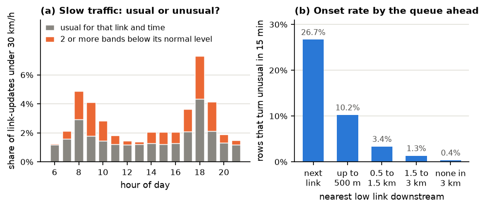
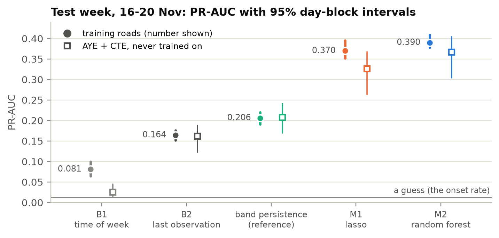
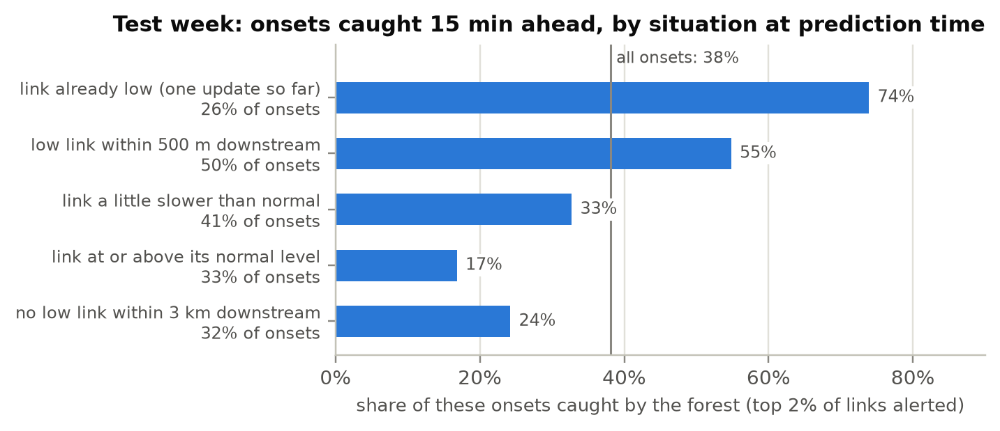

# Recurring or unusual? Early warning of abnormal slowdowns on Singapore expressways

42.510 Statistical Learning for Data Science, project 1.3. Team: Aveline, Liam, Juan Peng, Ronnie [TEAM: full names
and student IDs, as on the proposal].

**DRAFT of 28 Nov 2026.** Lines in [square brackets] are for the team. Limit: 6 pages for sections 1 to 7.

## 1. Abstract

Rush hour is slow every day; an operator needs to know when a road is slower than it *usually* is at that time. For
traffic-operations staff, we ask whether recent speeds on an expressway link and its neighbours, with rainfall and
time of day, can predict an unusual slowdown on that link 15 minutes ahead. We collected LTA's Traffic Speed Bands
for all 2,598 expressway links from 16 October to 20 November 2026 and built 10.3 million link-time rows. A link is
"unusual" when it is at least two speed bands below its own median for that time of day, twice in a row. We compare
two simple baselines with lasso logistic regression and a random forest, tuned on earlier days only and frozen before
the test week was opened. On the test week the forest reaches a precision-recall AUC of 0.390 (95% interval
0.378-0.409) and the lasso 0.370, against 0.164 for "last observation" and 0.081 for the time-of-week rate. The gain
holds on two expressways never used for fitting (0.367 against 0.162). The models are good at saying where a slowdown
that has started will spread; they rarely foresee one that starts on a clear road.

## 2. Problem and relevance

**Question.** For traffic-operations staff: can recent speeds on an expressway link and its neighbours, with rainfall
and time of day, predict whether that link will be unusually slow 15 minutes later?

**Audience and decision.** LTA's operations staff watch about 2,600 expressway links and can attend to only a few at
a time. A warning is useful if it points to links that are about to become abnormally slow, early enough to post a
message or send a recovery vehicle.

**Why "unusual".** Of all slow link-updates on training weekdays (under 30 km/h), 62% are normal for that link and
time. A plain "slow traffic" detector would mostly rediscover rush hour. We therefore measure each link against its
own normal level.

**Precise target.** One row is one link at one 5-minute update, 06:00-22:00, Monday to Friday without public
holidays. The *normal level* is the link's median speed band in that 15-minute slot over the training weekdays. The
*drop* is the normal level minus the band now. A link is *unusual* (U) when its drop is 2 bands or more (about
20 km/h) now and 5 minutes ago. We predict y = U 15 minutes later, and we score only rows where the link is still
normal now, because warning about a slowdown that is already visible helps nobody. About 1.2% of these rows turn
unusual. We claim prediction, not cause.

## 3. Data curation

**Sources.** LTA DataMall Traffic Speed Bands (eight bands of 10 km/h, updated about every 5 minutes; LTA DataMall
API User Guide, section 2.19), NEA 5-minute
rainfall, and public holidays, all under the Singapore Open Data Licence. LTA serves only the current state, so we
collected around the clock with two collectors and two API keys from 16 October, and archived every raw file with
checksums. Incident reports and PUB flood alerts were saved to help interpret results. They are never a model input,
and the flood feed held no alert in the period.

**Scope.** The proposal allowed us to select corridors to keep processing manageable. This was not needed: we kept
all 2,598 links of LTA's expressway category (ten expressways and two short flyovers).

**Construction.** The raw files become the model table in scripted steps (`analysis/build_data.py`):

1. Clean and merge both collectors: 89% of updates reached us more than once, and the copies never disagreed.
2. Resolve the link list and each link's neighbours (a link whose start lies within 5 m of another's end).
3. Compute the normal level from the 16 training weekdays only, then freeze it.
4. Build the label and the inputs on a regular 5-minute grid.

A missing update is reused for at most 5 minutes; rows that still lack the label or an input are dropped. The table
has 8.0 million usable training and validation rows and 2.3 million test rows.

**Inputs (96, all known at prediction time).** The build gives 53: the link's drop now and up to 30 minutes ago, the
largest drop on the links just upstream and downstream, the same for joining roads, rain in the last 15 and 30
minutes, time of day and day of week. We added three groups:

- *the normal level ahead* (8): the normal level of a future slot is fixed in advance, so we know how the link's
  usual speed is about to change;
- *queues within 3 km* (34): the largest drop and the share of low links in three rings along the road, in both
  directions, and the distance to the nearest low link;
- *the link's usual onset rate* at that time of day (1).

**Quality.** The median day has a band for 96% of the link-updates. Two weak days are kept and flagged. The build
runs 114 checks and stops on any failure; 25 unit tests cover its steps; an independent script recomputes sample
rows; and a notebook rebuilds all 29 training and validation days from the raw files, equal to the build in every
row and column. The data dictionary, the licence terms and every rule behind the table are in `DATA.md` and
`docs/data_rules.md`.

**What the exploration showed** (Figure 1). Slow traffic is mostly routine, which is why the label compares a link
with its own normal level. Onsets are rare (about 1% of rows) and bunch in the peaks. Their rate doubled from the
first training week to the later ones, and it is several times higher after rain (0.8% when dry, 9% after more than
5 mm in 30 minutes). A link's drop still correlates 0.57 with its value 15 minutes earlier, so rows are far from
independent. And onsets rarely come from nowhere: the rate is 27% when the next link downstream is already low, and
0.4% when no link within 3 km is.

**Limitations.** One season of school-term weekdays, with 16 training days. Bands are coarse, and the top band means
"70 km/h or more". A third of unusual episodes last only 10 minutes. Links that are normally at band 1-2 cannot show
a 2-band drop (0.6% of cells).

## 4. Methods and validation

**Split.** Training: 16 October to 6 November (16 weekdays). Validation: 10 to 13 November (4). Test: 16 to 20
November (5). Two whole expressways (AYE and CTE, 689 links), drawn with a fixed seed, are never used to fit, tune
or calibrate; they test transfer to unseen roads.

**Baselines.**
- *B1, time-of-week rate:* each link's historical onset rate in that 15-minute slot, pulled towards the slot's
  average when the link has little history.
- *B2, last observation:* the link's drop now.

**Models.**
- *M1, lasso logistic regression* (Tibshirani, 1996), on standardised inputs with time of day as hour groups. We fitted it with the
  glmnet algorithm (Friedman et al., 2010), because scikit-learn's saga solver hit its iteration limit at almost
  every penalty on our 4.6 million rows.
- *M2, random forest* (Breiman, 2001) with 400 trees, fitted on every onset and 10% of the other rows, then calibrated on the
  validation week (Platt, 1999).

The two families differ on purpose: one is linear and sparse, the other captures thresholds and interactions.

**Assumptions.** The lasso assumes that the inputs act additively on the log-odds; the forest does not. Both assume
that the coming week resembles the training weeks. The intervals treat days as exchangeable, and with five test days
they are rough.

**Tuning without leakage.** Because the onset rate drifts from week to week, settings were chosen by forward
validation inside the training days: fit on earlier days, check on later days, never shuffled. Scaling, the
usual-onset-rate input and the subsample were refitted inside each window. Input groups were kept only if they
raised the windowed score by 0.002, a rule fixed beforehand. The validation week chose the final model (the forest), its calibration and the alert share (2% of
links per update, by best F1). A finer scheme with six windows puts the frozen settings within 0.001 of its best.
Ten leakage checks passed (appendix G).

**Metrics, fixed before modelling.**
- Precision-recall AUC on rows that are normal now. A guess scores the onset rate, 0.0125.
- Precision and recall among the top 0.5%, 1% and 2% of links at each update.
- The share of unusual episodes warned 10-15 minutes before they start.

Accuracy is not used: never alerting is 98.8% accurate. Intervals resample whole days (2,000 draws), because rows 5
minutes apart are strongly dependent.

**Freeze.** Every setting and a hash of each model file were recorded on 25 November. The test week was then scored
once. Two later looks at the test week, from which nothing was chosen, are listed in appendix F.

## 5. Results

**Table 1. Test week (16-20 November), frozen settings.** Training roads: 1,636,522 rows, 20,499 onsets.

| | PR-AUC (95% interval) | Minus B2 (paired 95%) | Precision / recall at 2% | Episodes warned | PR-AUC on AYE + CTE |
|---|---|---|---|---|---|
| B1 time-of-week rate | 0.081 (0.064-0.100) | -0.083 | 0.084 / 0.135 | 15.8% | 0.025 |
| B2 last observation | 0.164 (0.152-0.176) | | 0.145 / 0.234 | 8.8% | 0.162 |
| M1 lasso | 0.370 (0.351-0.395) | +0.206 (+0.188 to +0.225) | 0.223 / 0.360 | 30.6% | 0.326 |
| **M2 random forest** | **0.390** (0.378-0.409) | +0.226 (+0.212 to +0.241) | 0.235 / 0.381 | 31.5% | 0.367 |

- **Both models more than double the better baseline** (Figure 2), on every test day (forest 0.378-0.423; B2
  0.144-0.181). The
  risk named in our proposal, that the models might not beat last observation, did not happen.
- **The forest leads the lasso by 0.020** (paired interval +0.012 to +0.027): small but consistent. The validation
  week had given the same order (forest 0.348, lasso 0.322, B2 0.128, B1 0.069).
- **The models transfer** to the held-out expressways (forest 0.367, interval 0.304-0.404).
- **A stronger simple rule** that we found during the analysis, *band persistence* (the drop the link would have in
  10 to 15 minutes if its band stayed the same), scores 0.206. The models are well above it too.
- **In use:** with 2% of links alerted (about 35 per update), 1 alert in 4 is right and 38% of onsets are caught.
  With 0.5% (about 9), 38.5% of alerts are right. Predicted probabilities are close to observed rates (1.12% predicted
  against 1.25% observed; Brier score 0.0094 against 0.0124 for the base rate).

**What drives the gain.** Without the neighbour inputs both models lose about 0.075 (lasso 0.296, forest 0.314); the
joining roads add nothing.
The forest relies most on the normal level ahead, then on the distance to the nearest queue downstream. The lasso's
largest coefficients are on the same kinds of input, and on the link's usual onset rate.

**Where the forest works and where it fails.** Figure 3 sorts the test-week onsets by what could be seen at the time
of prediction (the situations overlap).

A split into three exclusive groups on the validation week gives the same picture:

**Table 2. Validation week, forest, by what is known at prediction time.**

| Group | Share of onsets | PR-AUC | Caught |
|---|---|---|---|
| The slowdown is already forming on the link | 67% | 0.45 | 51% |
| A queue is just ahead | 11% | 0.24 | 35% |
| The link and the road ahead look normal | 22% | 0.05 | 3% |

Onsets with an incident report that begins inside the 15-minute window are caught no better than average (36%).

**Secondary analyses, fixed in advance.**
- At a 5-minute horizon last observation alone is already strong (B2 0.765, lasso 0.863).
- At 30 minutes last observation falls below the time-of-week rate (0.075 against 0.117), and the forest still
  reaches 0.259.
- On 1 km segments both models still beat last observation, by less (lasso 0.374, forest 0.362, B2 0.280).

**Other course tools, as benchmarks** (validation week; appendix C). Simpler tools from the course do worse than
the two models: one pruned decision tree reaches 0.26 to 0.27 and linear discriminant analysis 0.27, against 0.32 for
the lasso and 0.35 for the forest. Ridge and elastic net tie with the lasso, so the kind of penalty does not matter
here.

## 6. Discussion

**Answer.** Yes, partly. Speed bands of a link and its neighbours predict unusual slowdowns 15 minutes ahead far
better than either baseline, and the result transfers to roads the models never saw. But the models mostly predict
where an *existing* slowdown will spread or deepen. A slowdown that starts on a clear road gives almost no warning
in 10 km/h bands.

**Practical meaning.** A ranked list of 9 to 35 links per update is a watch list, not an automatic alarm: three out
of four alerts are false at the 2% share. Our data also arrive a median of 4 minutes late, so "15 minutes ahead" is
about 11 minutes in practice. The 2% share gives about as many alerts as a probability threshold that counts one
missed slowdown as 5 to 10 false alarms. Staff who know their costs can choose another threshold.

**Failures and limits.** New slowdowns are missed. Performance differs across the eight expressways we trained on
(0.24 to 0.44) and is lower off-peak (0.29 against 0.43). The label counts 10-minute dips. One season and 16
training days limit how far the results generalise. The forest's two best settings tied in tuning; the frozen choice
does not affect the conclusions (appendix A).

**Ethics.** The data are public road-level measurements; no person or vehicle is identified. How LTA computes the
bands is not published, so we cannot check whether some roads are measured less well than others. The model should
support staff, not replace their judgement, and its uneven performance across roads should be monitored.

**Next step.** Finer inputs (speeds rather than bands, or traffic counts) to see new slowdowns earlier, a longer
collection period, and an alert rule based on one probability threshold and stated costs.

## 7. Reproducibility and contributions

Code: [https://github.com/PressGO/slds-1.3]. The model tables are on the repository's Releases page, with checksums;
the raw files (about 9 GB) are in a shared folder [TEAM: say how the instructor gets access]. `README.md` and
`docs/REPRODUCE.md` give the steps from the raw files to every table and figure, in four parts: data collection and
transformation; exploration and inputs; models; summary. The results
in this report are printed by `notebooks/part4_summary.ipynb`; the exploration numbers by the Part 2 notebook.

| Member | Data task | Modelling task |
|---|---|---|
| Juan Peng | Collection and data quality | Baselines and failure cases |
| [name] | Labels and exploratory analysis | Lasso logistic regression |
| [name] | Analysis table and data dictionary | Random forest |
| [name] | Evaluation code and uncertainty | Sensitivity and transfer checks |

[TEAM: replace this table (it is the division in our proposal) with what each member actually did.]

## 8. References and AI-use disclosure

- Breiman, L. (2001). Random forests. *Machine Learning*, 45, 5-32.
- Friedman, J., Hastie, T., and Tibshirani, R. (2010). Regularization paths for generalized linear models via
  coordinate descent. *Journal of Statistical Software*, 33(1), 1-22.
- James, G., Witten, D., Hastie, T., and Tibshirani, R. (2021). *An Introduction to Statistical Learning* (2nd ed.).
  Springer.
- Land Transport Authority. *LTA DataMall API User Guide*, version 6.10. Traffic Speed Bands, section 2.19.
- Platt, J. (1999). Probabilistic outputs for support vector machines and comparisons to regularized likelihood
  methods. In *Advances in Large Margin Classifiers*. MIT Press.
- Saito, T., and Rehmsmeier, M. (2015). The precision-recall plot is more informative than the ROC plot when
  evaluating binary classifiers on imbalanced datasets. *PLoS ONE*, 10(3), e0118432.
- Tibshirani, R. (1996). Regression shrinkage and selection via the lasso. *Journal of the Royal Statistical
  Society: Series B*, 58(1), 267-288.
- Data: LTA DataMall; NEA rainfall and MOM public holidays from data.gov.sg; Singapore Open Data Licence 1.0.

**AI use.** We used Claude (Anthropic) to draft code, documentation and parts of this text. Every script was run
and checked by us; the checks are listed in `AI_USE.md` with dates and prompts. [TEAM: confirm.]

---

# Technical appendix (not counted in the 6 pages)

**A. Tuning.**
- *Lasso:* windowed PR-AUC is flat for weak penalties (0.3512 to 0.3530). The frozen penalty is 0.0003 times the
  largest useful penalty, and it keeps 97 of 111 columns. On 300,000 rows our solver reaches a lower objective than
  scikit-learn's after 5,000 epochs.
- *Forest:* a grid of max_features and leaf size. With leaf 20, max_features 0.35 and 0.6 tie at 0.3712. The written
  rule sends ties to the smaller value, but the frozen run kept 0.6, because part of its grid had been stored
  rounded. On the validation week the two score 0.3496 and 0.3482.
- *Six windows* (adding two days at a time): the frozen settings are within 0.001 of the best.

**B. Validation week.** B1 0.069, B2 0.128, lasso 0.322, forest 0.348; on AYE + CTE: B2 0.143, lasso 0.300, forest
0.335. ROC-AUC: forest 0.942, lasso 0.927, B2 0.771, B1 0.770. ROC-AUC ranks the models the same way but hides the
gap between the baselines, so PR-AUC is our main score (Saito and Rehmsmeier, 2015).

**C. Other course tools, on the validation week** (methods as in James et al., 2021).
- One pruned decision tree (47 to 83 leaves, chosen by the one-standard-error and minimum-error rules) reaches 0.26
  to 0.27. Unpruned, with 6,216 leaves, it scores 0.86 on its own rows and 0.24 on later days.
- Ridge and elastic net tie with the lasso.
- Linear discriminant analysis reaches 0.27. Quadratic discriminant analysis fails (0.08).
- Impurity and permutation importance agree on the leading inputs (Spearman 0.77).

**D. Input ablations, test week** (lasso / forest; main result 0.370 / 0.390).
- Without neighbour inputs: 0.296 / 0.314.
- Without joining roads: 0.370 / 0.390.
- Without the usual onset rate: 0.343 / 0.376. On AYE + CTE this version is better (0.336 / 0.384), because those
  roads have no history.
- The 53 build inputs only: 0.251 / 0.276.

**E. Subgroups, test week (forest).** Peak 0.428, off-peak 0.292; rain 0.423, dry 0.376; by expressway from 0.236
(KJE) to 0.443 (ECP). The two short flyovers, with about 20 and 100 onsets, score 0.03 and 0.23.

**F. The test week was read three times.**
1. The frozen run reported here (26 November).
2. A read-only curve of the forest's score by number of trees. Nothing was chosen from it.
3. An exploratory variant with extra inputs, fitted on 20 days (0.412). It is not our result.

[TEAM: keep or shorten this paragraph.]

**G. Leakage checks** (`results/tables/13_leakage_checks.md`). Ten checks passed: the days of the three splits never
mix; the normal level uses the training days only; a truncation test confirms that every input is known at
prediction time. One note: on training rows the usual-onset-rate input leaves the row's own day out, which leaves a
faint trace of the row's own answer. On the tuning windows it is worth about 0.003 of PR-AUC (0.3712, against 0.3686
with past days only). Validation and test rows never have it.
